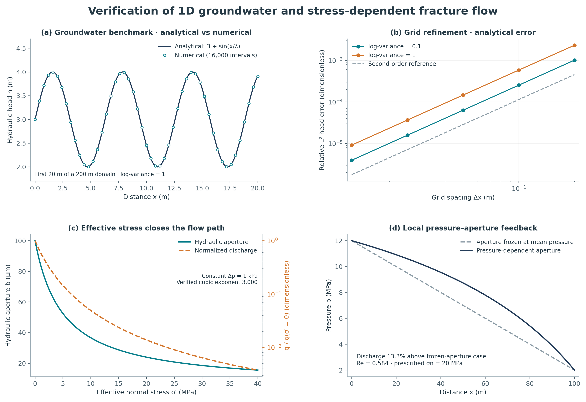

# Fracture Flow Benchmark

[](https://github.com/VahidKz/fracture-flow-benchmark/actions/workflows/ci.yml)

**Verify the groundwater solver, then investigate how effective stress changes fracture flow.**
An independently written Python reproduction of a published 1D benchmark, followed by
cubic-law verification and a steady pressure–aperture feedback experiment.



## Reproduce

Python 3.10+; NumPy, SciPy, Matplotlib. No external datasets or services are needed after installation.

```bash
git clone https://github.com/VahidKz/fracture-flow-benchmark.git
cd fracture-flow-benchmark
python -m venv .venv
# Activate: source .venv/bin/activate (Linux/WSL)
# Or: .venv\Scripts\Activate.ps1 (Windows PowerShell)
python -m pip install -c requirements-repro.txt -e .
python -m fracture_flow_benchmark reproduce
```

Use `python3` or `py` to create the environment if `python` is unavailable.
The command writes eight CSV tables, [metrics.json](results/metrics.json), and the figure
as [PNG](results/summary.png) and [SVG](results/summary.svg). It exits nonzero if accuracy
or conservation checks fail. Use `--output results-local/my-run` to preserve the committed results.

## Measured results

| Verification | Result |
| --- | --- |
| Groundwater, log-variance 0.1 / 1 | Relative L² head error **3.97e−6 / 9.18e−6** |
| Finest groundwater refinement | Observed convergence order **2.000 / 2.000** |
| Cubic-law aperture sweep | Fitted exponent **3.000000** |
| Nonlinear fracture vs independent quadrature | Relative discharge error **8.37e−7** |
| Nonlinear fracture conservation | Relative face-flux spread **9.96e−11** |

For the specified synthetic fracture, pressure-dependent aperture gives **13.3% more discharge**
than aperture frozen at mean pressure. The hydraulic-diameter Reynolds number is **0.584**, within
the conservative `Re < 1` screening criterion used here. These are verification and illustrative
model results, not experimental validation or a general prediction for natural fractures.

## Methods and limits

The groundwater experiment implements the [Alecsa et al. benchmark formulation](https://arxiv.org/html/1911.10774v2)
with our own committed seed-42 coefficient realization. It does **not** reproduce the authors’
exact random field or tables. Fracture flow follows the [cubic law](https://doi.org/10.1029/WR016i006p01016)
with an illustrative [hyperbolic closure relation](https://doi.org/10.1016/0148-9062(83)90595-8).
Hydraulic aperture follows a closure proxy; parameters are not fitted to rock measurements.

This is a 1D, saturated, isothermal, steady-flow study under prescribed normal stress.
It includes no geochemistry, shear, fracture propagation, fracture networks, or full poroelasticity.
See [equations, units, and numerical methods](docs/methods.md), [references](docs/references.bib),
and [software citation](CITATION.cff).

## Verification

```bash
python -m pip install -c requirements-repro.txt -e '.[dev]'
pytest -q
ruff check .
ruff format --check .
python -m build
```

CI checks Python 3.10 and 3.12, regenerates the experiments, and tests the installed wheel.
Runtime versions used for the committed results are pinned in `requirements-repro.txt`.
Code and generated coefficient data: MIT. Built with AI assistance; scientific sources are credited above.
